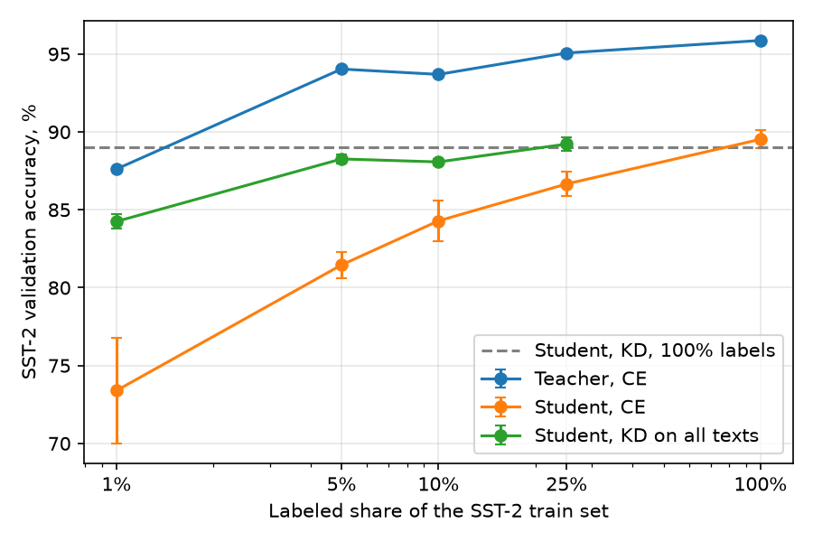

# Knowledge distillation into a 17M encoder with 10% of SST-2 labels

A 17M-parameter student distilled from a 400M teacher through all SST-2 train sentences reached 89.7% test accuracy with gold labels for 10% of them, against 84.3% with cross-entropy on the same labels and 89.5% with all labels. Group project of the ITMO "Efficient models" course, defense on 05.12.2026; method, questions, and schedule are in [`PLAN.md`](PLAN.md), slides in [`slides/slides.pdf`](slides/slides.pdf).

## Setup

The teacher is [Ettin-encoder-400m](https://huggingface.co/jhu-clsp/ettin-encoder-400m), the student [Ettin-encoder-17m](https://huggingface.co/jhu-clsp/ettin-encoder-17m): ModernBERT-architecture encoders from one pretraining recipe with one tokenizer ([Weller et al., 2025](https://arxiv.org/abs/2507.11412)). The task is GLUE SST-2 (binary sentiment, 67,349 train sentences); the GLUE validation split (872 sentences) is the test set. A random p% of the train set has gold labels; the random subsets are nested.

Knowledge distillation (KD, [Hinton et al., 2015](https://arxiv.org/abs/1503.02531)) trains the student on `(1 - a) * CE(student, gold) + a * T^2 * KL(teacher_T || student_T)`, where CE (cross-entropy) is averaged over the examples that have a gold label. By default `a = 0.5` and temperature `T = 2`. Run names:

| Run | Student training data | Loss |
|---|---|---|
| `teacher_p<p>` | p% labeled sentences | CE, the 400M teacher |
| `hard_p<p>` | p% labeled sentences | CE |
| `kd_p<p>` | p% labeled sentences | CE + KL from `teacher_p<p>` |
| `kdu_p<p>` | all 67,349 sentences, p% of them labeled | CE where labeled + KL from `teacher_p<p>` everywhere |

`kc10` in place of `p10` is a 10% chosen by k-center greedy ([Sener & Savarese, 2018](https://arxiv.org/abs/1708.00489)) on mean-pooled embeddings of the pretrained teacher. Suffixes `_t1`, `_t4` set `T = 1`, `T = 4`; `_a1` sets `a = 1` (KL only), `_t4a1` both; `_ts1`, `_ts2` distill from the teacher of seed 1 or 2; `_32m`, `_68m` replace the student by Ettin-encoder-32m or -68m. Hyperparameters are fixed, with no dev set: AdamW, batch 32, fp16; teacher LR 3e-5 for 3 epochs, student LR 1e-4 for 5 epochs, at least 300 steps. Students ran with 3 seeds; teachers with 1, except `teacher_p10` with 3. Students distill from the seed-0 teacher unless named `_ts1` or `_ts2`. The 83 runs and two benchmarks took 197 + 199 + 45 min in three sessions on one Kaggle T4.

## KD on unlabeled sentences closes 72% of the gap at 10% labels

| Run | Test accuracy, % | F1, % |
|---|---|---|
| `teacher_p10` | 94.1 ± 0.7 | 94.2 ± 0.6 |
| `hard_p10` | 84.3 ± 1.3 | 84.7 ± 1.2 |
| `kd_p10` | 84.1 ± 0.6 | 84.7 ± 0.5 |
| `kdu_p10` | 88.1 ± 0.2 | 88.4 ± 0.1 |
| `hard_p100` | 89.5 ± 0.6 | 89.8 ± 0.5 |
| `kd_p100` | 89.0 ± 0.3 | 89.4 ± 0.3 |

Mean ± sample standard deviation over 3 seeds; full table in [`results/summary.md`](results/summary.md), per-run files in [`results/runs/`](results/runs).

`kdu_p10` gained 3.8 points over `hard_p10`, 72% of the 5.2-point gap to `hard_p100`. The gain came from the 90% of sentences without gold labels: KD on the labeled 10% alone (`kd_p10`) was within the seed spread of `hard_p10`. With all labels, KD from `teacher_p100` (95.9%) did not raise the student either: `kd_p100` and `hard_p100` differ by 0.5 points, less than the sum of their standard deviations. The three `teacher_p10` seeds scored 93.7, 94.8, and 93.7%; students distilled from them scored 88.1 ± 0.2, 88.6 ± 0.4, and 88.4 ± 0.7%, so the teacher seed moved `kdu_p10` by at most 0.5 points. Over all 9 runs `kdu_p10` is 88.4 ± 0.5%, 77% of the gap.

## Without the CE term, KD with 10% of the labels matched CE with all labels

| Run | `T` | `a` | Test accuracy, % |
|---|---|---|---|
| `kdu_p10_t1` | 1 | 0.5 | 87.4 ± 0.3 |
| `kdu_p10` | 2 | 0.5 | 88.1 ± 0.2 |
| `kdu_p10_t4` | 4 | 0.5 | 88.8 ± 0.2 |
| `kdu_p10_a1` | 2 | 1 | 89.7 ± 0.3 |
| `kdu_p10_t4a1` | 4 | 1 | 89.3 ± 0.3 |
| `hard_p100` | | 0 | 89.5 ± 0.6 |

Dropping the CE term on the 6,735 gold labels raised the student by 1.6 points, to within the seed spread of `hard_p100`: trained only on the soft labels of a teacher that saw 10% of the gold labels, the student matched the student trained on all of them. Each step of the temperature from 1 to 2 to 4 added 0.7 points, more than the sum of the standard deviations. With `a = 1`, raising the temperature to 4 did not help: `kdu_p10_t4a1` is 0.4 points below `kdu_p10_a1`, less than the sum of their standard deviations. Neither setting was run at other label shares or student sizes.

## With KD, 5% of the labels beat 25% without it



| Labeled share | `teacher`, % | `hard`, % | `kdu`, % |
|---|---|---|---|
| 1% (673 sentences) | 87.6 | 73.4 ± 3.4 | 84.3 ± 0.5 |
| 5% (3,367) | 94.0 | 81.5 ± 0.8 | 88.3 ± 0.3 |
| 10% (6,735) | 94.1 ± 0.7 | 84.3 ± 1.3 | 88.1 ± 0.2 |
| 25% (16,837) | 95.1 | 86.7 ± 0.8 | 89.2 ± 0.4 |
| 100% (67,349) | 95.9 | 89.5 ± 0.6 | |

`kdu` runs use `T = 2`, `a = 0.5`. KD on all sentences with 1% of the labels matched CE with 10% (84.3% both), and with 5% it exceeded CE with 25% (88.3% vs 86.7%). The KD gain shrank from 10.9 points at 1% to 2.6 points at 25%. At 25% the KD student (89.2%) was within the seed spread of the student trained with CE on all labels (89.5%). The seed spread of the KD student was 0.2-0.5 points at every share, against 0.6-3.4 for CE. Teachers other than `teacher_p10` are single runs, and the `teacher_p10` seeds span 1.1 points, so `teacher_p5` scoring 0.1 points below their mean is not a result.

## A larger student gains less from KD

| Student | `hard_p10`, % | `kdu_p10`, % | `hard_p100`, % | Gap closed |
|---|---|---|---|---|
| Ettin-encoder-17m | 84.3 ± 1.3 | 88.1 ± 0.2 | 89.5 ± 0.6 | 72% |
| Ettin-encoder-32m | 88.0 ± 1.0 | 90.2 ± 0.5 | 89.6 ± 0.9 | over 100% |
| Ettin-encoder-68m | 89.6 ± 0.4 | 91.1 ± 0.4 | 92.4 ± 0.7 | 54% |

All with `T = 2`, `a = 0.5`. The KD gain at 10% labels fell from 3.8 points for the 17M student to 2.2 for 32M and 1.5 for 68M, while CE with 10% of the labels rose from 84.3 to 89.6%. For the 32M student, KD with 10% of the labels was within the seed spread of CE with all labels, as for the 17M student with `a = 1`. CE with all labels gave 17M and 32M the same accuracy (89.5 and 89.6%) and 68M 2.8 points more.

## K-center selection of the 10% lowered accuracy

| Run | Random 10%, % | K-center 10%, % |
|---|---|---|
| `teacher` | 93.7 | 92.8 |
| `hard` | 84.3 ± 1.3 | 79.1 ± 1.0 |
| `kdu` | 88.1 ± 0.2 | 86.7 ± 0.3 |

Teachers: seed 0. K-center selection cost the CE student 5.2 points and the KD student 1.4 points. The k-center subset had 57.3% positive labels against 55.2% in the random subset and 55.8% in the full train set.

## The student is 63 times faster than the teacher on CPU

| Model | Parameters, M | Without embeddings, M | CPU, batch of 32, ms | T4 fp16, sentences/s |
|---|---|---|---|---|
| Ettin-encoder-400m | 395.8 | 344.3 | 5,817 | 314 |
| Ettin-encoder-68m | 68.4 | 42.6 | 736 | 1,278 |
| Ettin-encoder-32m | 32.0 | 12.7 | 237 | 2,423 |
| Ettin-encoder-17m | 16.9 | 4.0 | 92 | 3,243 |

CPU latency is the median of 10 forward passes over 32 test sentences with 2 PyTorch threads on a Kaggle CPU; T4 throughput is measured on the 872 test sentences ([`results/runs/bench_sizes.json`](results/runs/bench_sizes.json)). The 17M student has 23 times fewer parameters than the teacher and 86 times fewer outside the embedding matrix; the 68M student is 8 times slower than the 17M one on CPU.

## Limits

Hyperparameters were not tuned for any run, and the student LR and epochs are those of the 17M student for all sizes. Only `teacher_p10` ran with 3 seeds; differences between other teachers below about 1 point are not results. CE with all labels gave the 17M and 32M students the same 89.5-89.6%; whether this is a limit of the recipe was not tested.

## Files

| Path | Content |
|---|---|
| `kd.py` | Data, training, KD loss, k-center, benchmark, the list of runs |
| `plots.py` | `results/summary.md` and `results/figures/label_curve.png` from the run files |
| `kd_kaggle.ipynb` | Runs `kd.py` on a Kaggle or Colab T4, resumes from earlier results, zips `results/` |
| `results/runs/` | One JSON per run: config, metrics, train time, environment; `bench*.json` for the benchmark |
| `results/logits/`, `results/subsets/` | Teacher logits on all train sentences, k-center indices |
| `slides/` | Beamer slides, `latexmk -pdf slides.tex` in that folder |
| `Dockerfile`, `pyproject.toml`, `uv.lock` | Pinned environment for `kd.py` and `plots.py` |
| `PLAN.md` | Method, questions, five-day schedule, papers |

## Reproduce

Kaggle: open [`kd_kaggle.ipynb`](https://kaggle.com/kernels/welcome?src=https://github.com/PE51K/itmo-ai-talent-hub-efficient-models-course/blob/main/project/kd_kaggle.ipynb) with a GPU and internet on, then Save Version -> Save & Run All. The notebook describes how to resume a stopped version from its output.

Colab, one T4: [`kd_kaggle.ipynb`](https://colab.research.google.com/github/PE51K/itmo-ai-talent-hub-efficient-models-course/blob/main/project/kd_kaggle.ipynb).

Locally:

```
uv sync
uv run python kd.py --smoke      # whole pipeline on CPU, 2,000 sentences, results_smoke/
uv run python kd.py              # all runs, needs a CUDA GPU, results/runs/<run>.json
uv run python kd.py kdu_p10_s0   # one run
uv run python plots.py           # results/summary.md, results/figures/
```

Docker, with the versions of `uv.lock` (needs the NVIDIA driver and the NVIDIA Container Toolkit on the host; a run whose file is in the mounted `results/` is skipped):

```
docker build -t kd-tiny .
docker run --rm kd-tiny kd.py --smoke                                   # CPU check
docker run --rm --gpus all -v "$PWD/results:/app/results" kd-tiny kd.py kdu_p10_s0
docker run --rm -v "$PWD/results:/app/results" kd-tiny plots.py
```

Environment of the reported runs: Kaggle, Tesla T4, Python 3.13.15, PyTorch 2.11.0+cu128, Transformers 5.16.1. The notebook uses the PyTorch and Transformers preinstalled on Kaggle; `uv.lock` and the Docker image pin PyTorch 2.15.0 and Transformers 5.21.1, which were not used for the reported numbers.
